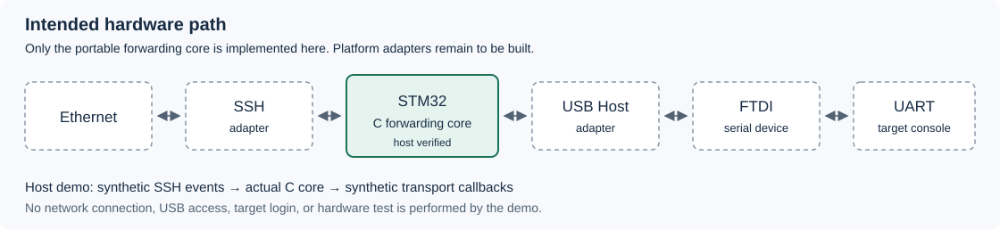

# STM32 SSH UART Gateway

A portable C core for a serial console gateway, with an intended hardware path from Ethernet and SSH through an STM32 board to a USB serial device.

**Status:** host reference implementation. The forwarding core, simulation, and tests are implemented. Ethernet, SSH, USB Host, and FTDI adapters are not implemented here. This repository does not contain flashable STM32 firmware.

Author: [darkimorta5](https://github.com/darkimorta5). License: [MIT](LICENSE).

## Architecture



The intended path is Ethernet → SSH → STM32 → USB Host → FTDI → UART. The core handles ownership, queues, and session lifecycle between two transport callbacks. Platform adapters will provide authentication, networking, USB enumeration, and serial configuration.

Keeping those boundaries separate lets the forwarding logic run and be tested without a board. The included example uses synthetic SSH input and UART output. It opens no network connection or hardware device.

## What the core does

* Grants one console owner at a time. A second request gets `BUSY` without disturbing the first owner.
* Forwards binary data in both directions without changing Enter, Backspace, Ctrl+C, or Ctrl+D.
* Handles partial writes and blocked callbacks using two fixed queues, with no heap allocation.
* Closes a session explicitly on overflow or a reported transport error, with counters for rejected and discarded bytes.
* Provides status snapshots and distinguishes SSH EOF, client close, and TCP abort.

The core generates no serial input on startup, open, idle, close, or error. It does not enter credentials, guess whether Linux is running, or send recovery commands. Only explicit input submitted by the current console owner can enter the UART queue.

## Build and test

Use CMake 3.20 or newer and a C compiler. There are no bundled platform libraries or downloaded runtime dependencies.

```sh
cmake -S . -B build -DCMAKE_BUILD_TYPE=Debug
cmake --build build --config Debug
ctest --test-dir build -C Debug --output-on-failure
```

On Windows, use a developer shell with the C toolchain and Windows SDK installed. The same CMake commands work with a suitable generator.

To display the host example through CTest:

```sh
ctest --test-dir build -C Debug -V -R host_demonstration
```

The example checks passive startup, a rejected second session, partial transfers, diagnostics, and close followed by a new session. Its output includes:

```text
Host simulation only. No SSH server or USB device is opened.
USB ready, console opened: autonomous UART bytes = 0
BUSY: another session owns the UART
diag: USB=ready active=1 UART_RX=6 UART_TX_ACCEPTED=5 SSH_TX_ACCEPTED=6
Closed and reopened: no queued bytes from the previous owner.
```

A Python helper can also build and run both executables:

```sh
python3 tools/build.py --cc cc
```

It accepts `--cc clang`, `--cc cl`, or `--cc zig` when that compiler is available. It writes a local report to `build/host-verification.json`.

## Integration model

Provide nonblocking `uart_write` and `ssh_write` callbacks, then initialize `gw_gateway`. Mark USB ready only after the serial adapter is usable. An authenticated SSH adapter can request ownership with `gw_open`.

Feed user input through `gw_from_ssh` with the current token, submit serial payload through `gw_from_uart`, and schedule `gw_poll`. Read `gw_snapshot` for readiness, pending bytes, counters, and the last close reason. All calls must run in one owner task or event loop.

The core does not replace an SSH server's connection and channel admission rules. See [architecture](docs/architecture.md) for lifecycle details and [porting notes](docs/porting.md) for the platform work still required.

## Verification and CI

Host tests exercise the actual C core, not a separate behavioral model. Coverage includes ownership, queue wrap, partial transfers, blocked output, overflow, stale events, USB detach, reported errors, and EOF deadlines.

[GitHub Actions](.github/workflows/ci.yml) is configured to build with GCC and Clang on Ubuntu and run both CTest entries. It has no deployment or publication step. A successful hosted run can only be claimed after the workflow has actually run.

See [verification](docs/verification.md) for local results and remaining gaps. No hardware tests of another implementation are presented as evidence for this code.

## Limits

The default queues are 256 bytes per direction. They demonstrate bounded buffering, not a throughput guarantee. Callback acceptance does not prove physical delivery or successful command execution. An overflow terminates the session instead of silently truncating the stream.

Closing SSH releases the owner and clears core queues, but does not log out the attached operating system. The next operator may inherit an existing shell. Delayed bytes already in a device or adapter are outside the core's control.

A silent UART is not proof that Linux has booted. The core never sends an automatic probe. User input can still interrupt a bootloader, so the operator and platform integration must enforce a safe input policy.

There is no verified ARM build, board configuration, RAM map, SSH interoperability result, baud rate claim, or hardware recovery guarantee. Read the [security notes](docs/security.md) before adapting this design to a real target.

## Next steps

1. Select a board and platform components with suitable licenses.
2. Implement authenticated SSH, Ethernet, USB Host, and FTDI adapters.
3. Measure memory use, scheduling latency, and client backpressure on that board.
4. Test real sessions, BUSY isolation, slow readers, USB removal, and independent board and target restarts.

## Source and license

The demonstration code was written independently for this repository. No customer source files, credentials, device settings, firmware images, or private test logs are included.

Original code and documentation are MIT licensed. Platform dependencies need a separate license review when they are added. See [source provenance](docs/provenance.md).
